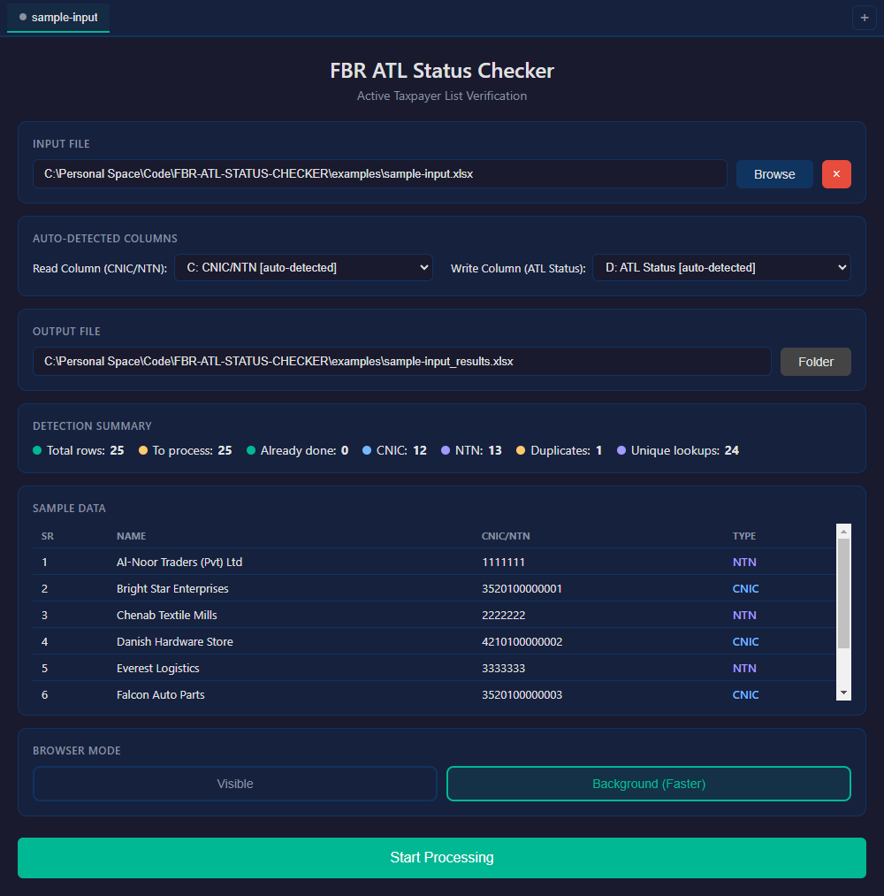
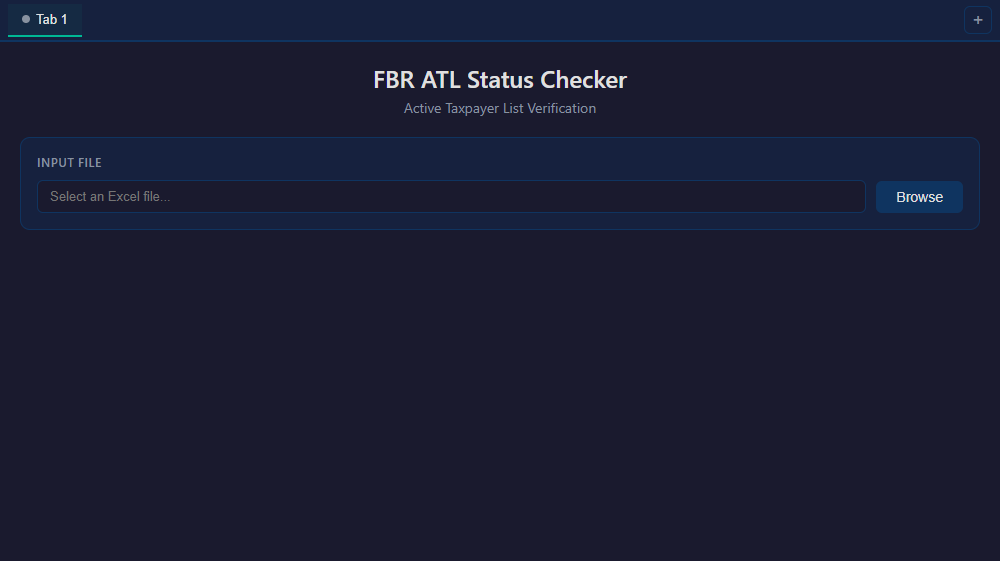
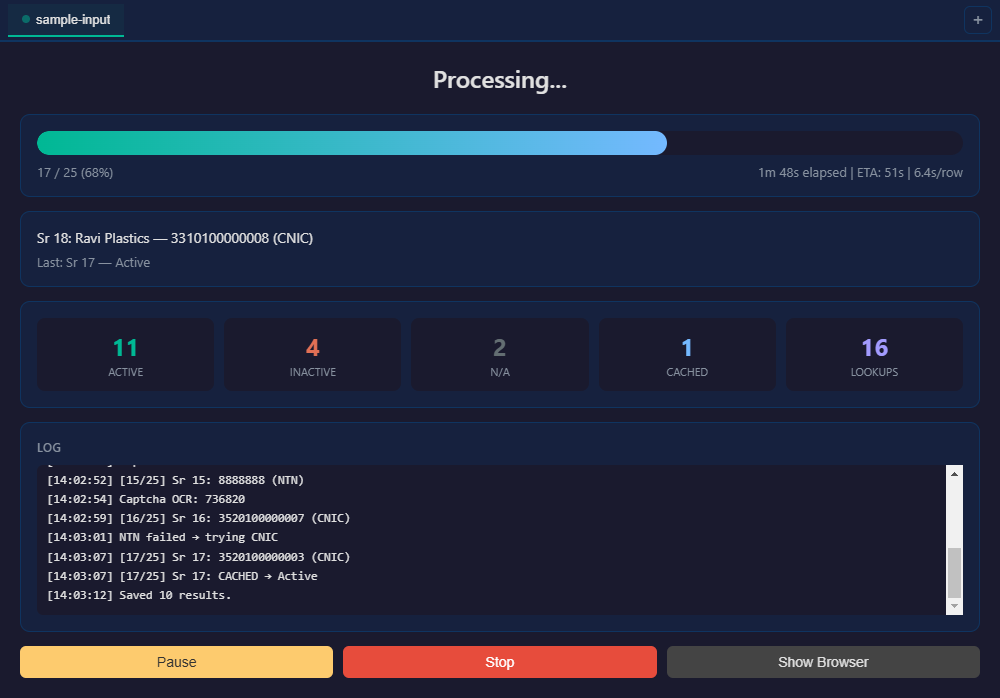
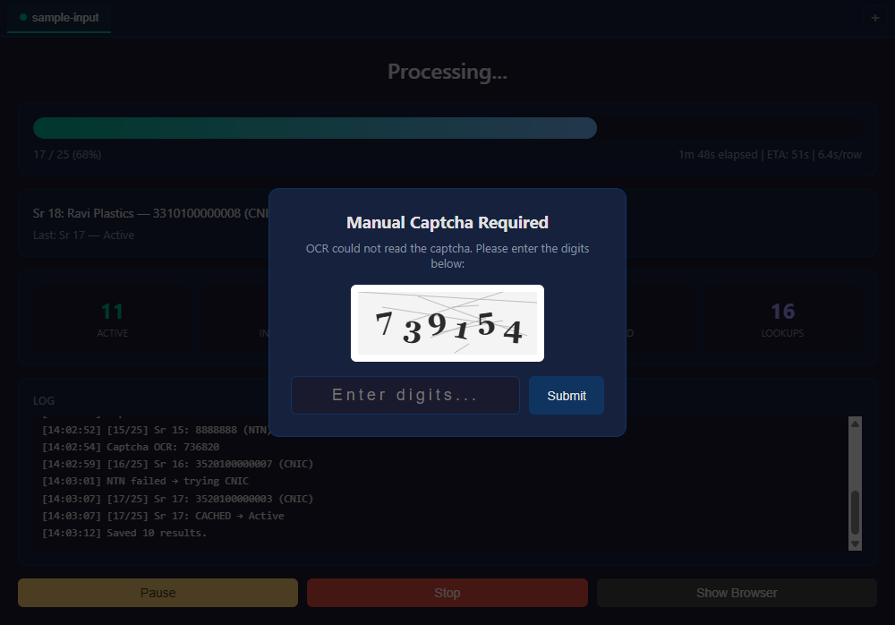
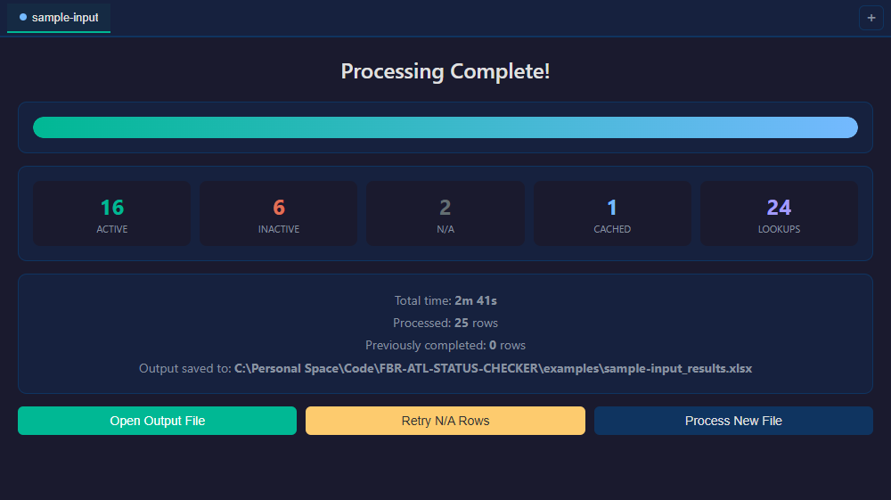
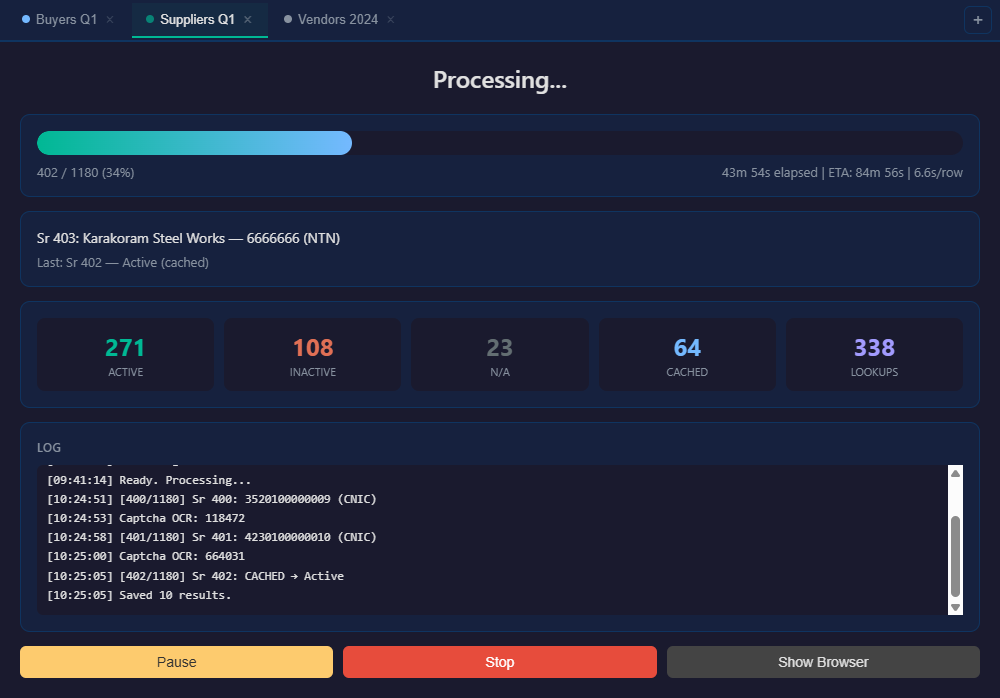

<div align="center">


# FBR ATL Status Checker

**Bulk-verify Active Taxpayer List status for hundreds of CNIC/NTN numbers — straight from your Excel file.**

[](https://github.com/ali-dev178/FBR-ATL-STATUS-CHECKER/releases/latest)
[](https://github.com/ali-dev178/FBR-ATL-STATUS-CHECKER/actions/workflows/ci.yml)
[](LICENSE)
[](#installation)

</div>

---

Checking one taxpayer's ATL status on the [FBR IRIS portal](https://iris.fbr.gov.pk/) takes about a minute: pick the parameter type, type the registration number, set the date, squint at a captcha, hit verify, copy the answer back into your spreadsheet. Doing that for a purchase register with 800 rows is a two-day job, and by row 300 the transcription mistakes have already crept in.

This app does the same thing, row by row, while you do something else. Point it at your Excel file, confirm the columns it detected, and press start. It fills the form, reads the captcha itself, scrapes the result, and writes the status back into a **copy** of your workbook — original formatting intact, original file untouched.

<div align="center">
  
</div>

## Contents

- [Features](#features)
- [Screenshots](#screenshots)
- [Installation](#installation)
- [Quick start](#quick-start)
- [Usage](#usage)
- [Excel file format](#excel-file-format)
- [How it works](#how-it-works)
- [Performance](#performance)
- [Project structure](#project-structure)
- [Development](#development)
- [Building distributables](#building-distributables)
- [Troubleshooting](#troubleshooting)
- [FAQ](#faq)
- [Roadmap](#roadmap)
- [Contributing](#contributing)
- [License](#license)
- [Disclaimer](#disclaimer)

## Features

**Works with the file you already have**

- No template to fill in — the app reads your existing spreadsheet
- Auto-detects the header row, the CNIC/NTN column, the ATL Status column, and the Sr No / Name columns used for progress display
- The read and write columns can be corrected from a dropdown if the guess is wrong (the Sr No and Name columns are display-only, and are detected on every run)
- Handles CNIC and NTN mixed in the same column, deciding per row
- Skips a title row above your header, blank rows, and sub-total rows
- Hidden columns are left out of the dropdowns so you do not pick one by accident

**Your data stays intact**

- The input file is opened read-only; results go to a separate output workbook
- Results are written by editing the `.xlsx` XML directly, so formatting, styles, column widths, merged cells and hidden columns survive untouched
- Results are flushed to disk every 10 rows — a crash costs you at most a few lookups

**Captchas solve themselves, with no paid API**

- Tesseract OCR reads the portal's numeric captcha locally, on your machine
- Up to 5 attempts per row, refreshing the captcha between tries
- On the rare occasion all 5 fail, a popup shows you the image so the run does not stall

**Built for long runs**

- **Resume** — stop anytime, even close the app; on restart it reads the output file and skips rows that already have a result
- **Duplicate cache** — a repeated CNIC/NTN is looked up once and reused instantly
- **Automatic retry** — 3 attempts per row for transient errors, plus a CNIC ↔ NTN fallback when the first type is rejected
- **Self-healing browser** — if the browser window is closed mid-run, the app reconnects in background mode and carries on

**Multiple files at once**

- Tabbed interface, one file per tab, each with independent progress and controls
- Tabs share a single browser and a single OCR worker, so a second file costs very little extra memory
- Tabs can be renamed (double-click) and are restored when you reopen the app

**Full control while it runs**

- Pause, resume and stop at any point
- Run the browser in the background (faster) or visible, and switch to visible mid-run without losing progress
- Live progress bar with elapsed time, ETA and seconds-per-row
- Counters for Active / Inactive / N/A / Cached / Portal lookups
- Timestamped activity log
- **Retry N/A rows** after a run, to re-attempt anything that came back "Record not exist"

**Cross-platform** — Windows and macOS builds, with Chromium bundled so there is nothing else to install. Linux builds are produced too, but are not regularly tested.

## Screenshots

<table>
  <tr>
    <td width="50%">
      <br>
      <b>1. Pick a file</b><br>
      <sub>A fresh tab. Everything else appears once a file is selected.</sub>
    </td>
    <td width="50%">
      <br>
      <b>2. Confirm what was detected</b><br>
      <sub>Read and write columns, output path, row counts, CNIC/NTN split, duplicates, and a preview of the first rows.</sub>
    </td>
  </tr>
  <tr>
    <td width="50%">
      <br>
      <b>3. Walk away</b><br>
      <sub>Captchas are read automatically, row after row. Progress with ETA, live counters, and a running log.</sub>
    </td>
    <td width="50%">
      <br>
      <b>4. Step in only if OCR misses</b><br>
      <sub>After five failed reads the captcha is shown so the run never stalls waiting on it.</sub>
    </td>
  </tr>
  <tr>
    <td width="50%">
      <br>
      <b>5. Open the results</b><br>
      <sub>Final tally, total time, and buttons to open the output or retry the N/A rows.</sub>
    </td>
    <td width="50%">
      <br>
      <b>Several files at once</b><br>
      <sub>Each tab runs independently, sharing one browser; the dot on each tab shows its state.</sub>
    </td>
  </tr>
</table>

<sub>Screenshots use the fictional data in [`examples/sample-input.xlsx`](examples/sample-input.xlsx) and are generated by [`scripts/capture-screenshots.js`](scripts/capture-screenshots.js). No real taxpayer records appear anywhere in this repository.</sub>

## Installation

### Download a build

Grab the latest build for your platform from the [Releases page](https://github.com/ali-dev178/FBR-ATL-STATUS-CHECKER/releases/latest):

| Platform | File | Notes |
|----------|------|-------|
| Windows | `FBR-ATL-Status-Checker-<version>-win-x64.exe` | Portable — no installer, just run it |
| macOS (Apple silicon) | `FBR-ATL-Status-Checker-<version>-mac-arm64.dmg` | Drag to Applications — needs macOS 13 Ventura or later |
| macOS (Intel) | `FBR-ATL-Status-Checker-<version>-mac-x64.dmg` | Drag to Applications — needs macOS 13 Ventura or later |
| Linux | `FBR-ATL-Status-Checker-<version>-linux-x86_64.AppImage` | `chmod +x` then run — community-supported, lightly tested |

Chromium is bundled inside the build, so there is nothing else to install. That is also why the downloads are large — 210–320 MB depending on platform, expanding to roughly 800 MB on disk.

The builds are **not code-signed**, so the operating system will warn you the first time:

- **Windows** — SmartScreen shows "Windows protected your PC" → *More info* → *Run anyway*
- **macOS** — "cannot be opened because the developer cannot be verified" → right-click the app → *Open* → *Open*, or run `xattr -dr com.apple.quarantine "/Applications/FBR ATL Status Checker.app"`

If that is a dealbreaker, build it yourself from source — it takes two commands.

### Run from source

Requires [Node.js](https://nodejs.org/) 20 or newer and [Git](https://git-scm.com/).

```bash
git clone https://github.com/ali-dev178/FBR-ATL-STATUS-CHECKER.git
cd FBR-ATL-STATUS-CHECKER

npm install
npx playwright install chromium   # one-time browser download
npm start
```

## Quick start

Try it end to end with the sample workbook that ships with the repo:

```bash
npm run sample   # writes examples/sample-input.xlsx
npm start
```

Click **Browse**, choose `examples/sample-input.xlsx`, and press **Start Processing**.

The sample contains 25 fictional buyers with placeholder CNIC/NTN values, so the portal will answer "Record not exist" for all of them — that is expected. What it demonstrates is the whole pipeline: header detection below a title row, the CNIC/NTN split, the duplicate cache firing on row 12, captcha solving, and a results file written next to the input.

## Usage

### The app

1. **Select a file.** Click **Browse** and pick an `.xlsx` file.
2. **Check the detection.** The app fills in:
   - **Read Column** — where CNIC/NTN numbers are read from
   - **Write Column** — where the ATL status is written; if no suitable column exists, it adds one after your last column
   - **Output File** — defaults to `<input-name>_results.xlsx` beside the input; edit the path directly or click **Folder** to move it

   The **Detection Summary** tells you how many rows will actually be processed: total rows, rows already done, the CNIC/NTN breakdown, duplicates, and how many unique portal lookups that works out to.
3. **Choose a browser mode.**
   - **Background (Faster)** — the browser runs hidden. Use this normally.
   - **Visible** — a Chromium window opens so you can watch. Slower, and closing that window interrupts the run (the app recovers by switching itself back to background mode).
4. **Start Processing.**
5. **Leave it alone.** Captchas are solved automatically as it goes. In the rare case OCR cannot read one after five tries, a popup appears with the image so the run does not stall — type the digits and press Enter.
6. **When it finishes**, use **Open Output File**, **Retry N/A Rows**, or **Process New File**.

**Handy to know**

| | |
|---|---|
| **Several files at once** | **+** in the tab bar opens another tab. Each has its own file, progress and controls. |
| **Rename a tab** | Double-click its label. |
| **Show the browser mid-run** | **Show Browser** switches every background tab to a visible window without losing progress. It is one-way for that session. |
| **Stop and come back later** | **Stop** finishes the current row and stops. Start the same file again — completed rows are skipped. |
| **After a crash** | Same thing. Progress lives in the output file, not in memory. |
| **Where results go** | A copy of your workbook, at the output path shown before you start. Your input file is never written to. |

### Command line

`automate.js` is a self-contained script that predates the app's engine. It is kept for headless batch runs and unattended jobs.

```bash
npm run cli                          # visible browser
node automate.js --headless          # no browser window
node automate.js --limit=50          # only the first 50 pending rows
node automate.js --headless --limit=100
```

It reads `Input.xlsx` from the project root and writes `output.xlsx` beside it, resuming from whatever is already in `output.xlsx`. Both paths are hard-coded at the top of the file.

The CLI is simpler than the app on purpose, and its column handling is stricter: the header row is found by looking for a cell containing "CNIC" or "NTN", the serial number must be in column A, and the name in column B. For anything else, use the app.

## Excel file format

There is no fixed template. The app looks for:

- A **header row** — the first row containing a cell with "CNIC" or "NTN" in it. Title rows above it are fine.
- A **CNIC/NTN column** — the cell that matched. If no header matches, the app scans the first 100 rows for CNIC/NTN-shaped values.
- An **ATL Status column** — the first header containing "ATL" or "Status". If there is none, a new column is added after the last one.
- Optionally a **serial column** (`Sr`, `Sr.`, `S.No`, `#`, `No`, `Serial`, `Row`) and a **name column** (any header containing `name`, `buyer`, `company`, `taxpayer`, `organization`, `entity`). These are only used to label rows in the progress display and log.

Example:

| Sr | Buyer Name | CNIC/NTN | ATL Status |
|----|------------|----------|------------|
| 1 | Al-Noor Traders (Pvt) Ltd | 1111111 | |
| 2 | Bright Star Enterprises | 3520100000001 | |
| 3 | Chenab Textile Mills | 2222222 | |

**Value handling**

- Exactly 13 digits → treated as a **CNIC**; anything else → **NTN**
- Non-alphanumeric characters are stripped before submission, so `35201-0000000-1` is submitted as `3520100000001`
- If the portal rejects the guessed type, the other type is tried before the row is given up on

**Rows that are skipped**

- Rows with an empty CNIC/NTN cell
- If a serial column exists, rows where the serial is not a number — this is what filters out sub-headers, blank separators and total rows

**What gets written**

One of `Active`, `In-Active`, or `Record not exist`, exactly as the portal reports it. `Record not exist` is what the N/A counter tracks, and what **Retry N/A Rows** re-attempts.

## How it works

```
 Excel in ──► detect.js ──► AutomationEngine ──► portal.js ──► IRIS portal
                              │      ▲               │
                   cache hit  │      │ captcha.js ───┘  (Tesseract OCR,
                              │      │                   manual fallback)
                              ▼      │
                          excel.js ──┘
                              │
                              ▼
                      Excel out (a copy)
```

For each pending row:

1. **Cache check.** If this CNIC/NTN was already resolved in this run — or already had a result in the output file — the stored status is reused and no request is made.
2. **Parameter type.** CNIC or NTN, from the shape of the value.
3. **Registration number.** Typed character by character, dispatching an `input` event per character, because the portal's Angular form ignores a value set in one go.
4. **Date.** Today's date.
5. **Captcha.** The captcha `<canvas>` is exported as a PNG and passed to Tesseract with a digits-only whitelist. Under 4 digits recognised, the captcha is refreshed and retried, up to 5 times. After that the image goes to the GUI for manual entry.
6. **Verify**, then the result panel is scraped for the filing status.
7. **Fallback and retry.** A captcha error, a timeout or a "try again" response is treated as transient and retried (3 attempts per row). A rejection of the registration number retries with the other parameter type. If everything fails, the row is recorded as `Record not exist`.
8. **Write.** The status is queued and flushed to the output workbook every 10 rows, and again at the end.

**Design decisions worth knowing**

- **Excel is written as XML, not through a library.** ExcelJS drops formatting when it writes, which is unacceptable when the input is someone's formatted purchase register. `engine/excel.js` opens the `.xlsx` as a ZIP, edits `xl/worksheets/sheetN.xml` in place, and writes the archive back. It copies the style index from a neighbouring cell in the same row so the new cell inherits the row's borders and fills. ExcelJS is still used, but only for *reading* results back.
- **Browsers and the OCR worker are shared.** `engine/SharedResources.js` keeps at most one headless and one visible Chromium alive for the whole app; each tab gets a page, not a browser. OCR requests from all tabs are serialised through a single Tesseract worker, which is why a second or third file costs so little.
- **Resume state lives in the output file.** Nothing about progress is persisted separately. On start, the engine reads the write column of the output workbook and treats any non-empty cell as done. That makes resume work identically after a clean stop, a crash, or a reboot.
- **Only tab configuration is persisted**, to `tab-state.json` in the app's user-data directory — file paths, column choices and browser mode, so reopening the app puts you back where you were.

## Performance

Measured on a normal broadband connection; the portal is the bottleneck, not the app.

| | |
|---|---|
| Typical lookup | 5–8 seconds |
| Repeated CNIC/NTN | instant, no request |
| Row already in the output file | instant, skipped |
| Files in parallel | 4–5 tabs works comfortably |
| Memory | ~400 MB total, shared across tabs |
| Restart cost | none — completed rows are never redone |

As a rough guide, a 500-row file with 15% duplicates takes around 45 minutes. Portal response times vary a lot through the day, and captchas that need manual entry add however long you take to answer.

## Project structure

```
FBR-ATL-STATUS-CHECKER/
├── main.js                    Electron main process — window, IPC, tab lifecycle
├── preload.js                 Context bridge exposing window.api to the renderer
├── automate.js                Standalone CLI (self-contained, predates engine/)
├── renderer/
│   ├── index.html             Tab UI; screens cloned from a <template>
│   ├── app.js                 Frontend logic — TabState, IPC listeners, DOM
│   └── styles.css
├── engine/
│   ├── AutomationEngine.js    Row loop, pause/resume/stop, caching, retries
│   ├── SharedResources.js     Shared Chromium instances + Tesseract worker
│   ├── portal.js              IRIS navigation, form filling, result scraping
│   ├── captcha.js             OCR loop with refresh-and-retry
│   ├── detect.js              Excel parsing and column auto-detection
│   ├── excel.js               Format-preserving xlsx writer (JSZip)
│   └── browserPath.js         Locates the bundled Chromium per platform
├── scripts/
│   ├── check.js               Smoke checks (npm run check)
│   ├── generate-sample.js     Rebuilds examples/sample-input.xlsx
│   ├── generate-icons.js      Renders assets/icon.svg to png + ico
│   ├── capture-screenshots.js Regenerates the README screenshots
│   ├── install-bundled-chromium.js  Puts Chromium where the build can find it
│   └── recon/                 Throwaway probes for re-reading the portal's markup
├── examples/sample-input.xlsx Fictional demo data
├── assets/                    App icon (svg source + generated raster)
└── screenshots/               Images used by this README
```

**How the pieces talk.** The renderer calls `window.api.*` (defined in `preload.js`), which maps onto `ipcMain` handlers in `main.js`. `AutomationEngine` is an `EventEmitter`; `main.js` subscribes to its `progress`, `log`, `row-start`, `row-complete`, `captcha-manual`, `done` and `error` events and forwards them to the renderer, batching progress and log updates into one message every 2 seconds so a fast run cannot flood the UI.

## Development

```bash
npm start              # run the app
npm run check          # smoke checks — no browser or network needed
npm run sample         # rebuild examples/sample-input.xlsx
npm run icons          # rebuild assets/icon.png and icon.ico from icon.svg
npm run screenshots    # rebuild the README screenshots
npm run browsers       # download Chromium into the location builds read from
```

`npm run check` covers module loading, column detection against the sample workbook, and the output writer — including an assertion that the input file is byte-identical after a write. It needs no network access, which is what CI runs on every push.

There is no unit-test suite yet. Anything touching the portal is verified by running the app; see [CONTRIBUTING.md](CONTRIBUTING.md) for what to exercise before opening a pull request.

**When FBR changes the portal**, the selectors in `engine/portal.js` and `engine/captcha.js` are what break. `scripts/recon/` holds small Playwright scripts that dump the live page's structure, selectors and captcha markup — start there.

## Building distributables

```bash
npm run dist:win     # Windows portable .exe
npm run dist:mac     # macOS .dmg
npm run dist:linux   # Linux AppImage
npm run dist:all     # all three
npm run pack         # unpacked directory, for debugging a build
```

Output lands in `dist/`.

Each of these first runs `npm run browsers`, which downloads Chromium into `node_modules/playwright-core/.local-browsers` — the location `extraResources` copies into the packaged app. A plain `npx playwright install chromium` puts it in a shared per-user cache instead, where the build cannot reach it. This is why builds are self-contained and why they are large.

electron-builder can only build a macOS `.dmg` on macOS. The [release workflow](.github/workflows/release.yml) builds each platform on its own runner, which is the easiest way to produce all three.

## Troubleshooting

| Symptom | What to do |
|---------|-----------|
| "Could not find CNIC/NTN column in this file" | No header cell contains "CNIC" or "NTN". Rename the header, or pick the column manually after selecting any file the app does accept. |
| Nothing happens after **Start Processing** | Launching Chromium takes a few seconds — check the log box for `Launching browser...`. The very first captcha also downloads the OCR language model (~10 MB), so a fresh install pauses once before the first result. Running from source, make sure `npx playwright install chromium` has been run. |
| Stuck on the first captcha, or OCR never succeeds on a fresh install | The English OCR model is fetched from the jsdelivr CDN the first time it is needed. If your network blocks it, every captcha falls through to manual entry. |
| Every row comes back "Record not exist" | Usually the values themselves — confirm the Read Column is the right one in the Detection Summary. If the sample file also returns real results and yours does not, the values are being read from the wrong column. |
| Captchas keep falling through to manual entry | OCR normally handles these. If it suddenly stops, the portal has changed its captcha rendering — switch to Visible mode to see what it now looks like, and open an issue with a screenshot. |
| "Target page has been closed" | The visible browser window was closed. The app reconnects in background mode automatically and continues. |
| It sits on "Navigating to IRIS portal..." and retries | FBR sometimes puts a promotional dialog on the landing page, which locks page scrolling. The app closes any such dialog by itself. If a new variant slips past it, open a "Portal changed" issue with a screenshot — the dismissal lives in `dismissPopups()` in `engine/portal.js`. |
| Results are correct but formatting is gone | Should not happen — results are written into the xlsx XML precisely to avoid it. Please open an issue with the file structure (not the data). |
| The app opens with tabs from last time and one file is missing | Expected. A tab whose file has moved is restored empty. Pick the file again. |
| The app will not start after an update | Delete the state file and reopen: `%APPDATA%\fbr-atl-checker\tab-state.json` (Windows), `~/Library/Application Support/fbr-atl-checker/tab-state.json` (macOS), `~/.config/fbr-atl-checker/tab-state.json` (Linux). |
| macOS says the developer cannot be verified | The build is unsigned. Right-click → *Open*, or `xattr -dr com.apple.quarantine "/Applications/FBR ATL Status Checker.app"`. |
| `npm run dist:mac` fails on Windows | macOS builds require macOS. Push a tag and let the release workflow build it. |

## FAQ

**Do I need an IRIS login?**
No. ATL verification is a public page — the same one anyone can use without signing in.

**Is my input file modified?**
No. It is opened for reading only. Everything is written to the output workbook, which starts as a copy.

**Can I stop a long run and finish it tomorrow?**
Yes. Stop, close the app, reopen it, select the same input file and press start. Rows that already have a result in the output file are skipped.

**How many files can I run at once?**
4–5 tabs is comfortable. They share one browser, so the limit is the portal's patience rather than your machine's.

**Does it work for Sales Tax ATL?**
Not currently — only the Income Tax Active Taxpayer List. See the [roadmap](#roadmap).

**Does the captcha solving cost anything?**
No. Tesseract runs locally, on your machine. There is no third-party captcha service and no API key anywhere in this project. The one-off download of its English language model is the only thing the app fetches from anywhere other than the portal.

**Does it work offline?**
No — the portal lookups obviously need internet, and on a fresh install the OCR model is downloaded once from a CDN before the first captcha can be solved. After that, OCR itself is entirely local.

**Why is the download so large?**
A full Chromium build is bundled so the app works on a machine with nothing else installed.

## Roadmap

Ideas, roughly in order of usefulness. Issues and pull requests welcome on any of them — see [CONTRIBUTING.md](CONTRIBUTING.md).

- **Other FBR verifications** — Sales Tax ATL, and the other lookups on the same portal
- **Summary reports** — a per-run summary sheet, or a consolidated workbook across several files
- **Multi-sheet workbooks** — choose which sheet to process instead of always using the first
- **Scheduled runs** — unattended daily or weekly checks over a fixed file
- **Notifications** — a desktop or email nudge when a long run finishes
- **Bundle the OCR language model** — so a fresh install needs nothing from a CDN
- **A real test suite** — the smoke checks are a start, not a substitute
- **Proper Linux support** — the build exists; it needs someone to actually run it
- **Auto-update** — so a new release does not mean a manual download
- **Urdu UI**

## Contributing

Contributions are welcome — bug reports, portal-selector fixes after an FBR change, documentation, and features from the roadmap. [CONTRIBUTING.md](CONTRIBUTING.md) covers the setup, what to test by hand, and the commit conventions.

Please read the [Code of Conduct](CODE_OF_CONDUCT.md), and report security issues privately using the process in [SECURITY.md](SECURITY.md) rather than in a public issue.

## License

[MIT](LICENSE) © Ali Muhammad

## Disclaimer

This tool automates a **publicly accessible** verification page on the FBR IRIS portal. It performs the same lookups a person would perform by hand, one at a time, and it does not attempt to bypass authentication, access non-public data, or hide that it is a browser.

It is meant for legitimate business use — accountants, auditors and businesses checking the ATL status of their own suppliers, buyers and clients. Use it responsibly:

- Do not run more instances than you would reasonably use by hand. The portal is public infrastructure.
- Only look up numbers you have a genuine business reason to check.
- Handling other people's tax identifiers carries obligations under applicable privacy and data-protection law. That is on you, not on this tool.
- Comply with FBR's terms of use. They can change, and they take precedence over anything written here.

Results come from the portal and are only as current as the portal is. **Verify anything consequential directly.** This software is provided as-is, with no warranty; see the [LICENSE](LICENSE). The authors are not responsible for misuse, nor for decisions made on the basis of its output.

This project is not affiliated with, endorsed by, or connected to the Federal Board of Revenue.
